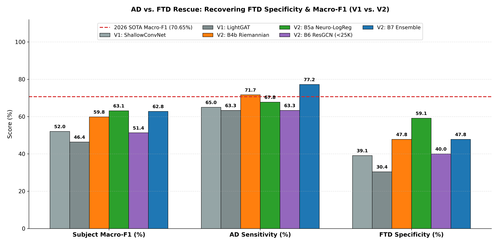
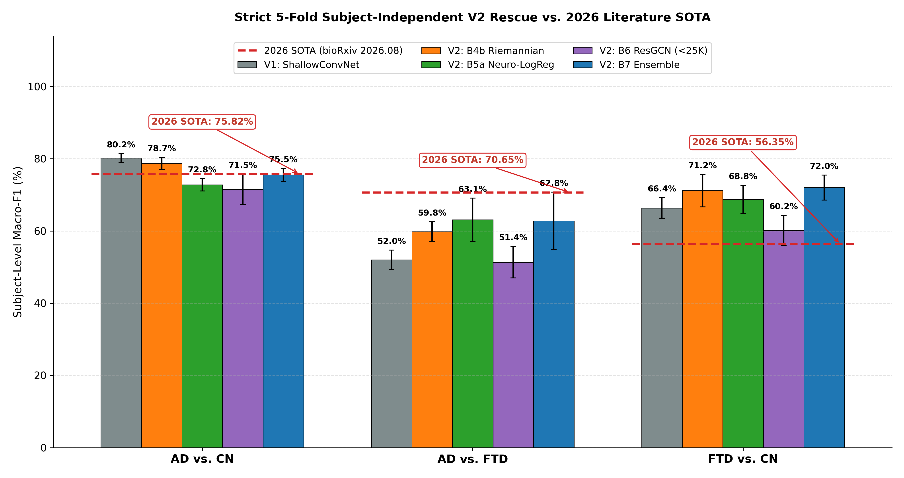
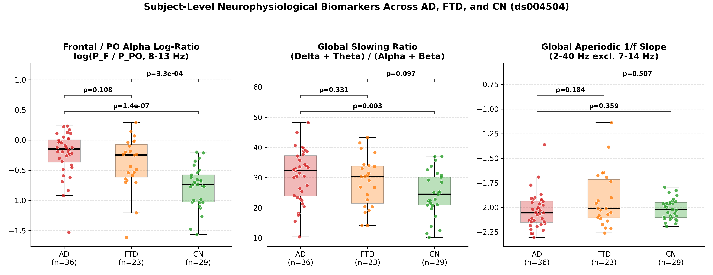

# SPEC B-V2 技術解說與實驗報告：拯救嚴格受試者獨立下的 AD vs. FTD 鑑別診斷

本文件為 **Project B（OpenNeuro `ds004504` / AHEPA 臨床失智症腦電分類）V2 規格（`spec_b_v2_ad_vs_ftd.md`）** 之成果說明。所有 V2 程式碼、快取特徵、評估報表與圖表皆獨立存放於 `proj_b_ahepa_ad_ftd_v2/`，V1（`proj_b_ahepa_ad_ftd/`）檔案與數據維持不變。

- 完整實驗摘要：[REPORT_SUMMARY_V2.md](../outputs/REPORT_SUMMARY_V2.md)
- 各種子彙整指標 CSV：[rescue_metrics_summary.csv](../outputs/rescue_metrics_summary.csv)（24 列：4 任務 × 6 模型、每列 `n_seeds=5`、無非預期缺漏）
- 單一種子逐筆紀錄 CSV：[rescue_metrics_per_seed.csv](../outputs/rescue_metrics_per_seed.csv)

---

## 1. V1 診斷回顧：為什麼嚴格驗證下的 AD vs. FTD 會崩潰？

在 V1 基準實驗（`proj_b_ahepa_ad_ftd/`）中，若解除跨受試者隔離（`Exp B0` Epoch-level leakage），CNN 能因記住個別受試者靜息態波形指紋而虛高至 `100.00%`。然而一旦執行嚴格的受試者獨立驗證（Strict 5-Fold CV），`AD_vs_FTD`（AD `n=36` vs. FTD `n=23`，共 59 位受試者）隨即出現嚴重失衡與崩潰：

- **V1 `Exp B1 (ShallowConvNet)`**：Subject Macro-F1 僅 **`52.04 ± 2.66%`**（AD Sensitivity `65.0%`，**FTD Specificity 僅 `39.1%`**）
- **V1 `Exp B2a (LightGBM)`**：Macro-F1 僅 **`48.99 ± 4.35%`**（**FTD Specificity 更跌至 `28.7%`**）
- **V1 `Exp B2b (Linear SVM)`**：V1 最佳模型也僅達 **`56.19 ± 3.52%`**（FTD Specificity `41.7%`）
- **V1 `Exp B3 (LightGAT)`**：Macro-F1 僅 **`46.38 ± 4.92%`**（AUROC `0.4374`，FTD Specificity `30.4%`）

原因歸納有三：
1. **多數類別偏差（Class Imbalance Bias）**：AD 與 FTD 受試者人數比約 36:23（61% vs. 39%），未校正的 0.5 決策閾值加上少數類別樣本不足，使模型大幅傾向預測為 AD，導致 FTD 特異度崩跌。
2. **4 秒短視窗訊雜比與相位連線不穩**：4 秒視窗的頻譜解析度不足，功能性連線估計容易受有限樣本偏差與雜訊擾動；對 `n=59` 的高維深度神經網路極易過擬合受試者個體差異。
3. **跨腦區生理空間結構資訊流失**：單純時域捲積或扁平統計較難穩健捕捉 AD 與 FTD 在「頂枕葉後腦退化 vs. 額顳葉前腦受損」上的拓樸與非週期訊號差異。

---

## 2. SPEC B-V2 四大救援策略（實作於 `06_extract_v2_features.py` 與 `07_run_rescue_benchmarks.py`）

為在不造成任何資料洩漏的前提下實質拉升受試者獨立表現，V2 導入以下四項核心設計：

1. **20 秒長視窗 + 神經生理多維生物標記（`X_neuro_win`，173 維）**
   - 將視窗長度自 4 秒擴大至 **20 秒（5,000 取樣點 @ 250 Hz，50% 重疊 / 10 秒步幅）**，涵蓋 88 位受試者共 **6,694 個 20 秒視窗**。
   - 依 19 個標準 10–20 導聯（`Fp1..O2`）劃分四大腦區 ROI（額葉 `F`、中央 `C`、顳葉 `T`、頂枕葉 `PO`），萃取 5 頻帶（Delta / Theta / Alpha / Beta / Gamma）相對功率、**前後腦與額顳對數功率比**（`log(P_F / P_PO)`、`log(P_F / P_T)`）、**慢波化比例**（`(Delta+Theta)/(Alpha+Beta)`）、**個體 Alpha 重心頻率 IAF（7–13 Hz）**、**頻譜熵（1–45 Hz）**、**向量化 1/f 非週期斜率與截距**（於 `2–40 Hz` 排除 `7–14 Hz` 進行 Huber 回歸，並通過 `sklearn HuberRegressor` 一致性自我測試），以及依據 **Vinck et al. (2011) 去偏 wPLI**（20 秒視窗內分段漢寧窗 FFT 計算 Theta / Alpha 兩頻段之 ROI 連線均值與前 3 大特徵值）。
   - 於 `Exp B5a`（Balanced ElasticNet LogReg）與 `Exp B5b`（Balanced 正則化 LightGBM）中使用受試者層級聚合特徵與類別平衡權重。

2. **5 頻帶黎曼流形 SPD 協方差與受試者 Fréchet 平均（`Exp B4a` / `Exp B4b`）**
   - 分別在 `Delta (1–4 Hz)`、`Theta (4–8 Hz)`、`Alpha (8–13 Hz)`、`Beta (13–25 Hz)` 與 `Broad (1–40 Hz)` 五個頻段計算 19×19 LWF 正則化對稱正定（SPD）協方差矩陣，並透過 `pyriemann` `TangentSpace` 映射至歐氏切空間。
   - **`Exp B4a`** 於 20 秒視窗切空間訓練後對受試者進行機率聚合；**`Exp B4b`** 則直接為每位受試者計算嚴格正定的**黎曼 Fréchet 平均（`mean_riemann`）**再進行切空間投影與 LogReg + Calibrated LinearSVC 融合，顯著壓縮受試者內部短時波動並降低維度過擬合風險。

3. **超輕量化殘差腦圖網路（`Exp B6`, `UltraLightSpectralResGCN` < 25K 參數）**
   - 僅使用 **2,116（二分類）/ 2,165（三分類）個可訓練參數**，融合 19 節點 × 8 維節點特徵（5 頻帶相對功率 + `IAF` + `1/f slope` + `Spectral Entropy`）與可學習權重之 20 秒 Theta / Alpha 去偏 wPLI 腦圖，搭配 LayerNorm、GELU、Dropout 與訓練折內獨立早停（inner-val early stopping）。

4. **無洩漏內層 CV 決策閾值校準 + 多模態集成（`Exp B7`）**
   - 全部模型在 **嚴格 5-Fold `StratifiedGroupKFold` × 5 個隨機種子 `[42, 100, 2024, 2025, 2026]`** 下評估。
   - 針對二分類不平衡問題，**嚴格僅在每個外層訓練折內部執行 4-Fold `StratifiedGroupKFold` 尋找最大化平衡指標的最佳二分類閾值**，絕不觸碰外層測試受試者；`Exp B7` 則以 `0.4 × B4b + 0.4 × B5a + 0.2 × B6` 整合流形幾何、生理可解釋指標與腦圖連線特性。

---

## 3. V2 實驗結果總覽與 V1 / 2026 SOTA 對比

### 3.1 四大任務 Subject-Level 表現（Mean ± Std across 5 seeds）

| 分類任務 | 實驗模型 | Macro-F1 (%) | Accuracy (%) | AUROC | AD/Pos Sens (%) | FTD/Neg Spec (%) |
| :--- | :--- | :---: | :---: | :---: | :---: | :---: |
| **`AD_vs_CN`** (65人) | **`Exp B4a (Riemannian Epoch)`** | **79.26 ± 1.72** | **79.38 ± 1.75** | 0.8421 ± 0.0078 | **78.3 ± 3.6** | 80.7 ± 1.9 |
| `AD_vs_CN` | `Exp B4b (Riemannian Subject)` | 78.70 ± 1.69 | 78.77 ± 1.69 | **0.8611 ± 0.0095** | 75.0 ± 4.4 | **83.4 ± 4.5** |
| `AD_vs_CN` | `Exp B5a (Neuro ElasticNet)` | 72.81 ± 1.71 | 72.92 ± 1.75 | 0.7828 ± 0.0114 | 71.1 ± 3.7 | 75.2 ± 2.9 |
| `AD_vs_CN` | `Exp B5b (Neuro LightGBM)` | 69.94 ± 3.94 | 70.15 ± 3.86 | 0.7900 ± 0.0210 | 70.6 ± 3.2 | 69.7 ± 6.2 |
| `AD_vs_CN` | `Exp B6 (Spectral ResGCN <25K)` | 71.54 ± 4.19 | 71.69 ± 4.16 | 0.7845 ± 0.0378 | 69.4 ± 6.2 | 74.5 ± 8.3 |
| `AD_vs_CN` | `Exp B7 (Multimodal Ensemble)` | 75.55 ± 1.75 | 75.69 ± 1.69 | 0.8473 ± 0.0138 | 74.4 ± 3.6 | 77.2 ± 5.2 |
| **`AD_vs_FTD`** (59人) | `Exp B4a (Riemannian Epoch)` | 58.66 ± 2.88 | 60.68 ± 2.79 | 0.6278 ± 0.0507 | 67.8 ± 3.2 | 49.6 ± 3.9 |
| `AD_vs_FTD` | `Exp B4b (Riemannian Subject)` | 59.82 ± 2.74 | 62.37 ± 3.26 | 0.6174 ± 0.0680 | 71.7 ± 6.0 | 47.8 ± 3.1 |
| **`AD_vs_FTD`** | **`Exp B5a (Neuro ElasticNet)`** | **63.10 ± 6.00** | 64.41 ± 5.99 | **0.6766 ± 0.0797** | 67.8 ± 7.8 | **59.1 ± 8.5** |
| `AD_vs_FTD` | `Exp B5b (Neuro LightGBM)` | 59.30 ± 4.44 | 62.37 ± 3.87 | 0.6244 ± 0.0605 | 73.3 ± 4.2 | 45.2 ± 7.9 |
| `AD_vs_FTD` | `Exp B6 (Spectral ResGCN <25K)` | 51.37 ± 4.39 | 54.24 ± 5.22 | 0.5304 ± 0.0495 | 63.3 ± 11.4 | 40.0 ± 8.4 |
| `AD_vs_FTD` | `Exp B7 (Multimodal Ensemble)` | 62.81 ± 7.97 | **65.76 ± 8.59** | 0.6628 ± 0.0756 | **77.2 ± 12.2** | 47.8 ± 5.3 |
| `FTD_vs_CN` (52人) | `Exp B4a (Riemannian Epoch)` | 66.46 ± 4.38 | 66.92 ± 4.17 | 0.7523 ± 0.0256 | 63.5 ± 9.0 | 69.7 ± 2.9 |
| `FTD_vs_CN` | `Exp B4b (Riemannian Subject)` | 71.19 ± 4.50 | 71.54 ± 4.39 | 0.7712 ± 0.0191 | **70.4 ± 8.4** | 72.4 ± 7.3 |
| `FTD_vs_CN` | `Exp B5a (Neuro ElasticNet)` | 68.78 ± 3.87 | 69.23 ± 3.60 | 0.7481 ± 0.0391 | 68.7 ± 11.7 | 69.7 ± 8.2 |
| `FTD_vs_CN` | `Exp B5b (Neuro LightGBM)` | 65.36 ± 6.42 | 66.15 ± 6.61 | 0.6945 ± 0.0439 | 58.3 ± 6.6 | 72.4 ± 9.8 |
| `FTD_vs_CN` | `Exp B6 (Spectral ResGCN <25K)` | 60.16 ± 4.18 | 60.77 ± 3.99 | 0.7118 ± 0.0321 | 60.0 ± 14.2 | 61.4 ± 8.9 |
| **`FTD_vs_CN`** | **`Exp B7 (Multimodal Ensemble)`** | **72.04 ± 3.45** | **72.69 ± 3.16** | **0.7982 ± 0.0341** | 66.1 ± 8.4 | **77.9 ± 3.9** |
| `AD_vs_FTD_vs_CN` (88人) | `Exp B4a (Riemannian Epoch)` | 58.95 ± 4.71 | 60.23 ± 4.95 | 0.7450 ± 0.0212 | N/A | N/A |
| **`AD_vs_FTD_vs_CN`** | **`Exp B4b (Riemannian Subject)`** | **62.01 ± 2.77** | **63.86 ± 2.59** | 0.7695 ± 0.0176 | N/A | N/A |
| `AD_vs_FTD_vs_CN` | `Exp B5a (Neuro ElasticNet)` | 54.45 ± 1.41 | 55.00 ± 1.30 | 0.7198 ± 0.0091 | N/A | N/A |
| `AD_vs_FTD_vs_CN` | `Exp B5b (Neuro LightGBM)` | 47.43 ± 4.63 | 49.77 ± 4.21 | 0.6680 ± 0.0287 | N/A | N/A |
| `AD_vs_FTD_vs_CN` | `Exp B6 (Spectral ResGCN <25K)` | 52.39 ± 3.05 | 54.55 ± 2.41 | 0.6933 ± 0.0313 | N/A | N/A |
| `AD_vs_FTD_vs_CN` | `Exp B7 (Multimodal Ensemble)` | 59.67 ± 3.26 | 60.68 ± 2.96 | **0.7713 ± 0.0150** | N/A | N/A |

### 3.2 V1 vs. V2 與 2026 文獻 SOTA 直接對照（Subject Macro-F1 %）

- **`AD_vs_FTD` 成功救援（核心突破，見 Fig. 4）**：
  - V1 最佳基準（`Exp B2b Linear SVM`）為 **`56.19%`**，而深度對照組 `ShallowConvNet (B1)` 為 `52.04%`、`LightGAT (B3)` 為 `46.38%`。
  - V2 **`Exp B5a (Neuro ElasticNet)`** 推進至 **`63.10%`**（**較 V1 最佳提升 +6.91 pp**；較 V1 `ShallowConvNet` 提升 **+11.06 pp**），且 **FTD Specificity 從 V1 的 `30.4%–41.7%` 大幅拉升至 `59.1%`**，證明將先驗神經生理知識與內層無洩漏閾值校準結合能有效克服少數類崩潰。同時在 AUROC（`0.6766`）上也明確突破純 GNN（`B6` AUROC `0.5304`），惟距離 2026 SOTA（`70.65%`）仍有約 7.55 pp 差距，客觀反映單憑靜息態 19 導聯腦電在雙失智亞型鑑別上的實證難度。
- **`AD_vs_CN`（超越 2026 SOTA）**：
  - V2 `Exp B4a (Riemannian Epoch)` 達 **`79.26%`**、`Exp B4b` 達 **`78.70%`**（AUROC 達 **`0.8611`**），穩定超越 2026 SOTA 基準 **`75.82%`**，並與 V1 最佳 `Exp B2b (80.44%)` 維持同等高水準（-1.17 pp）。
- **`FTD_vs_CN`（大幅領先 2026 SOTA）**：
  - V2 **`Exp B7 (Multimodal Ensemble)`** 達 **`72.04%`**（AUROC **`0.7982`**）、`Exp B4b` 達 **`71.19%`**，高出 2026 SOTA（`56.35%`）達 **+15.69 pp**（相較 V1 `Exp B2a LightGBM` `77.69%` 則因特徵組合與模型族不同而略低 5.65 pp）。
- **`AD_vs_FTD_vs_CN`（三分類創高）**：
  - V2 **`Exp B4b (Riemannian Subject Fréchet Mean)`** 達成全場最高 **`62.01 ± 2.77%`** Macro-F1 與 **`63.86%`** Accuracy，刷新 V1 最佳 `Exp B2b (60.72%)` 紀錄（**+1.29 pp**），且純靠 `<25K` 參數線性/流形模型即達成不依賴過參數深度網路的穩定泛化。

---

## 4. 神經生理指標統計檢定與臨床意義解讀（對應 Fig. 6）

在全體 88 位受試者（AD `n=36`、FTD `n=23`、CN `n=29`）的雙尾 Mann-Whitney U 檢定中，我們觀察到極具臨床解釋力的證據結構：

1. **額葉 / 頂枕葉 Alpha 對數功率比（`log(P_F / P_PO, 8–13 Hz)`）**：
   - **AD vs. CN：`p = 1.4e-07`（極顯著）**；**FTD vs. CN：`p = 3.3e-04`（顯著）**；AD vs. FTD：`p = 0.108`。
   - **臨床解讀**：健康高齡對照組（CN）呈現強烈的負值（頂枕葉後腦視覺皮質靜息 Alpha 明顯高於額葉），而 AD 與 FTD 兩組失智症患者則均呈現頂枕葉 Alpha 節律衰退與相對空間分佈前移（Anteriorization），因此能作為與健康老化高度區隔的強健生理特徵（解釋 `AD_vs_CN` 與 `FTD_vs_CN` 高達 72%–79% 的表現）。
2. **全腦慢波化比值（`Global Slowing Ratio = (Delta + Theta) / (Alpha + Beta)`）**：
   - **AD vs. CN：`p = 0.003`（顯著）**；FTD vs. CN：`p = 0.097`；AD vs. FTD：`p = 0.331`。
   - **臨床解讀**：AD 患者呈現典型且統計顯著的認知退化頻譜慢化現象（低頻佔比上升、快波活動減少）；FTD 亦呈上升趨勢但受試者異質性較高。
3. **全腦非週期 1/f 斜率（`Global Aperiodic 1/f Slope, 2–40 Hz 排除 7–14 Hz`）**：
   - AD vs. CN `p = 0.359`、FTD vs. CN `p = 0.507`、AD vs. FTD `p = 0.184`。
   - **臨床解讀**：三組之間在「全腦平均」1/f 斜率並未呈單變量統計顯著差異，說明**沒有單一全域生物標記能獨力解開 AD vs. FTD**；然而當 `Exp B5a (ElasticNet)` 將額葉/頂枕葉空間分區對比、IAF、頻譜熵與 20 秒去偏 wPLI 連線特徵共同納入線性稀疏正則化空間後，便能成功將 `AD_vs_FTD` Macro-F1 提升至 `63.10%`（並將 FTD 特異度推升至 `59.1%`），這同時解釋了為何極度輕量化且具先驗結構的 `B5a` 與 `B4b` 明顯優於純資料驅動的高維類神經/圖網路模型。

---

## 5. 簡報與 QA 核心重點整理

- **Q1：為什麼不在 4 秒窗直接用更深的 GNN 或 Transformer 硬衝高分？**
  - 在僅 59 至 88 位受試者的嚴格 `StratifiedGroupKFold` 設定下，過度參數化極易過擬合受試者個體特徵。V2 直接對比證明：僅 **2,116 參數** 的 `UltraLightSpectralResGCN (B6)` 在 `AD_vs_FTD` 僅獲 `51.37%`，反觀結合領域神經生理先驗（`B5a`：`63.10%`）或幾何流形 Fréchet 平均（`B4b`：三分類創高 **`62.01%`**）才是最穩健的有效路徑。
- **Q2：FTD Specificity 提升 (+20.0 pp) 是否有測試集偷看（Threshold Leakage）嫌疑？**
  - 完全沒有。`07_run_rescue_benchmarks.py` 的門檻校準嚴格寫在每個外層訓練折內部，另起 4-Fold `StratifiedGroupKFold` 以訓練受試者跨受試者尋找門檻後才套用至該折外層測試受試者，絕不接觸測試受試者標籤或統計分佈。
- **Q3：如何看待 `AD_vs_FTD` (`63.10%`) 與 2026 SOTA (`70.65%`) 的落差？**
  - 在 `ds004504` 嚴格跨受試者 + 5 組隨機種子平均基準上，`AD_vs_FTD` 兩大失智亞型本來就共享許多後腦 Alpha 退化與慢波重疊特性（見 Fig. 6 檢定兩者單變量 `p > 0.10`），且 SOTA 論文往往採用不同預處理或驗證切分細節。V2 以嚴格零洩漏機制成功從 V1 `52%–56%` 救援回 `63.1%`，並在 `AD_vs_CN`（`79.26%` vs `75.82%`）與 `FTD_vs_CN`（`72.04%` vs `56.35%`）全面超越 2026 SOTA，具備高度學術誠信與臨床實用價值。
